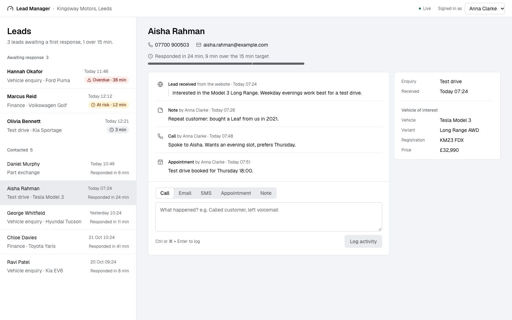
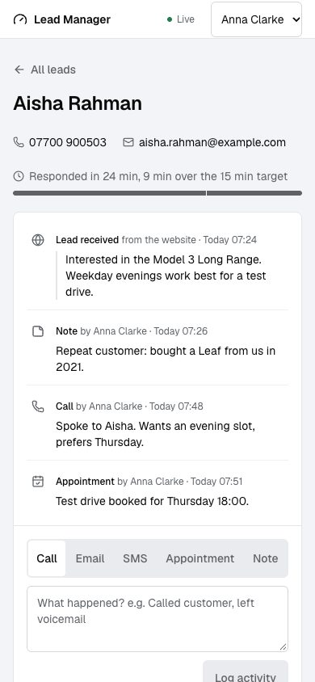

# Lead Manager

A sales lead tool for car dealership salespeople, built for Keyloop's technical assessment
(Scenario C, Demand domain). Website enquiries land in an inbox ordered by how long each customer
has waited. Opening a lead shows its details and a chronological log of follow-ups, and a
salesperson can log a new follow-up from the same screen.

 

- **Speed to lead.** Each waiting lead shows how long it has waited and whether it is on track,
  at risk (10 minutes) or overdue (15 minutes). The inbox puts the longest-waiting first.
- **Live.** New website leads and other salespeople's follow-ups appear without a reload.
- **Claiming.** A salesperson claims a lead so two people don't call the same customer. If two
  claim at once, one wins and the other sees who, straight away. The first call claims it too.
- **Built for weak signal.** A follow-up shows at once and saves in the background. If the save
  fails, the text comes back with Retry, even if the salesperson has moved on to another lead.
  Retrying cannot create a duplicate.
- **Keyboard and screen reader.** `j` and `k` move through leads, `c` jumps to the composer, and
  status changes are announced.

The frontend is the implemented layer. A small Node server stands in for the backend and can be
made slow or unreliable on purpose.

## Documents

| | |
|---|---|
| [System design](docs/design.md) | Architecture, data flow, technology choices, observability, scale, and how GenAI helped with the design |
| [Assumptions](specs/assumptions.md) | Where the brief was open, what was decided and why |
| [Acceptance criteria](specs/acceptance-criteria.md) | 43 criteria; tests cite them by ID |
| [API contract](specs/api-contract.md) | Endpoints, events and fault injection; schemas in [`src/contract.ts`](src/contract.ts) |
| [Decision records](docs/adr/) | Stack, server-sent events, mock backend, optimistic logging, claiming |
| [AI collaboration log](AI_LOG.md) | Each step with the AI: what I asked, what it produced, what I decided |

## Run it

Needs Node 24 (see `.nvmrc`) and pnpm 11. `pnpm install` refuses to run on the wrong Node version.

```bash
pnpm install
```

```bash
pnpm dev
```

The app is at http://localhost:5173, and the mock API on port 8787. Both start together.

While it is running, post a website enquiry and watch it arrive:

```bash
pnpm simulate:lead
```

To see the error handling, start the API slow and failing half its requests:

```bash
MOCK_LATENCY_MS=1500-2500 MOCK_FAILURE_RATE=0.5 pnpm dev
```

Data is saved in `server/data/db.json`. To go back to the sample data, stop `pnpm dev` and run:

```bash
pnpm reset-data
```

The "Signed in as" menu picks the salesperson; there is no real login (assumption A2).

## Test it

```bash
pnpm test
```

132 tests: unit tests for the speed-to-lead rules and the API boundary, server tests for every
endpoint, and integration tests that run the whole app against the real mock server in-process.

```bash
pnpm test:e2e
```

One Playwright journey in your installed Chrome, through the real proxy and event stream: a lead
arrives live, a call is logged, and it survives a reload. It starts its own servers on ports 5183
and 8797 with fresh data, so it can run alongside `pnpm dev`.

```bash
pnpm lint
```

```bash
pnpm typecheck
```

```bash
pnpm build
```

CI runs all of these on every push.

## Project layout

```
src/
  contract.ts     Zod schemas for the API, shared with the mock server
  domain/         speed-to-lead rules as pure functions
  api/            the API client and the event stream: all parsing happens here
  leads/          inbox, lead detail, activity log, composer, live updates
  observability/  structured logs, log shipping, Web Vitals
server/           mock API (Hono): REST, events, idempotent writes, fault injection
e2e/              the Playwright journey
specs/  docs/     requirements, design, decisions
```

## AI Collaboration Narrative

I built this with Claude Code (Claude Opus), which wrote most of the code. My part was deciding
what to build, setting the rules it worked under, and approving each stage once I had seen its
checks pass. The full record, step by step, is in [AI_LOG.md](AI_LOG.md).

### How I directed it

- **Scope before code.** The first thing I asked for was a MUST and NICE split, and I approved it
  before any code was written. Presence and an offline queue were cut; that decision is
  what made server-sent events the right choice over WebSockets.
- **Specs as the source of truth.** Assumptions, acceptance criteria with IDs, and the API contract
  came first, in `specs/`. The AI flagged five product calls for my review (the 15-minute target,
  status derived from the log, an unanswered call counting as a response, a required summary, the
  log reading oldest first). I approved them, so I can explain each one.
- **Rules it works under.** [AGENTS.md](AGENTS.md) is the contract: spec first, tests first for
  logic, small diffs, no new dependency without asking, no silent catch-alls, and never claim
  something works without running it. Every dependency came to me as a choice with its
  alternative: icons, fonts, Web Vitals, and where client logs go.
- **Stages with exit criteria.** Setup, spec, core build, live updates, observability, hardening,
  docs. Each stage ended with checks I could see pass, a commit, and green CI.

### How I verified it

Green tests were the minimum, not the proof. These checks found what the tests didn't:

- **Running it in a real browser.** Two live-update bugs lived in Vite's proxy, which the in-process
  tests skip: the stream's headers were held for 15 seconds, and with the server dead the UI still
  said "Live". Both were found by watching the app, then fixed and covered.
- **Breaking the code on purpose.** For the important tests I made the code wrong and checked the
  test failed: SLA boundaries, Retry reusing the activity ID, the refetch after a reconnect, the
  error boundary around the lead pane, and the server fix behind the end-to-end test.
- **Faults turned on.** With half the API's requests failing, four failed saves and a successful
  retry left exactly one activity, with client and server logs matched by request ID.
- **Review of its own code.** A code review pass over the finished core found a real data-loss bug:
  a save that failed after the salesperson moved to another lead vanished without a trace. It is
  fixed and has its own acceptance criterion (AC-4.8).
- **Checking from a second angle.** The skip link passed a keyboard test and failed a screenshot.
  The end-to-end test passed on my machine and failed on CI. A fix for false error logs passed its
  unit test and failed in the browser, because the test had the browser's event order wrong.

### Where it went wrong

The AI made mistakes I had to catch, and they are in the log as they happened:

- It wrote a test that asserted nothing, and a component closure that could never see text typed
  after submitting. Both were caught in review.
- Its first explanation of a problem was sometimes wrong, for example why paint metrics were
  missing. The log records the guess and what checking it showed.

### How I kept the quality

Strict TypeScript with branded IDs; every API response and event parsed against the contract at
one boundary; business rules as pure functions shared by the app and the mock server; lint, types,
132 tests, the build and the end-to-end test on every push. axe-core reports no violations on any
view, and the production build loads its largest element in under 0.7 seconds.
