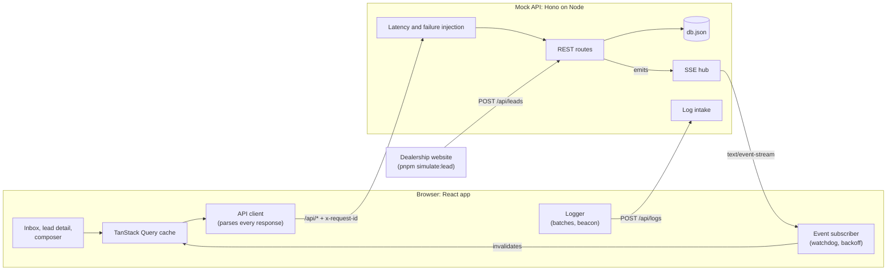
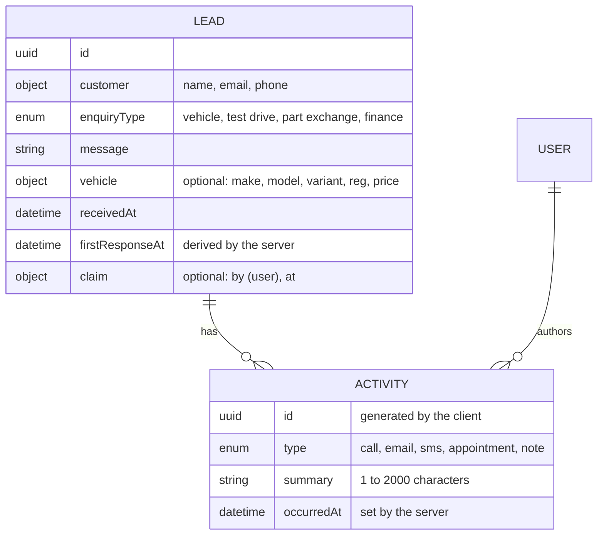
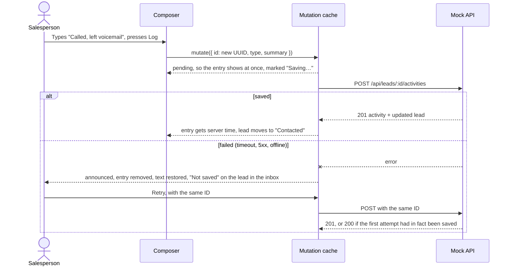
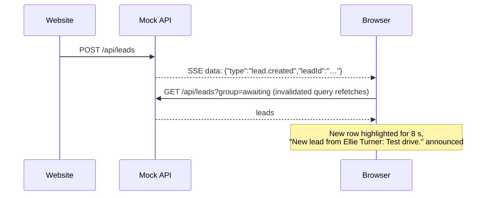
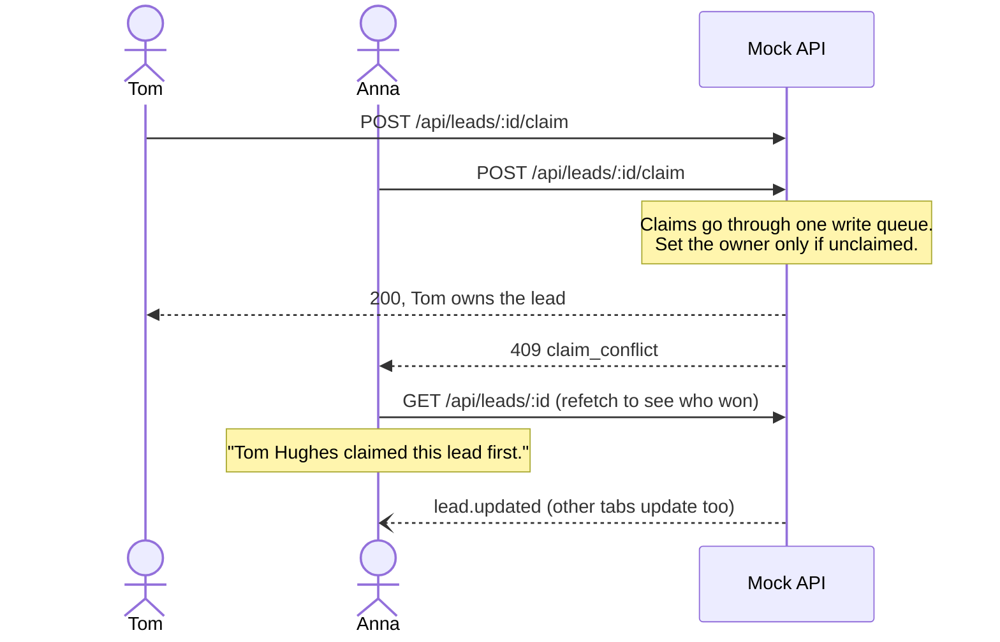
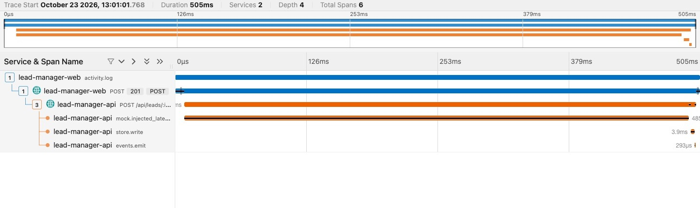
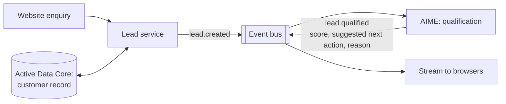

# Lead Manager: system design

A sales lead tool for Keyloop's Demand domain (Scenario C). Salespeople see website enquiries in an
inbox, open one to see its details and a chronological log of follow-ups, and log new follow-ups.
The frontend is the implemented layer. A small Node server stands in for the backend.

The core metric is **speed to lead**: how long a customer waits for a first response. It drives the
inbox order, the timers on each lead, and the overdue flags.

Requirements and decisions live in the repository, and this document links to them rather than
repeating them:

- [`specs/assumptions.md`](../specs/assumptions.md): 17 assumptions where the brief was open
- [`specs/acceptance-criteria.md`](../specs/acceptance-criteria.md): 56 criteria with IDs that tests cite
- [`specs/api-contract.md`](../specs/api-contract.md) and [`src/contract.ts`](../src/contract.ts): the API
- [`docs/adr/`](adr/): six architecture decision records

## 1. Context

Keyloop's Fusion platform has four domains; this tool belongs to Demand. Two things on Keyloop's
roadmap shaped it:

- **Sales Hub and AIME.** Keyloop agreed to acquire Motortech.ai in January 2026, whose AIME agent
  qualifies leads, to fold into Sales Hub. Lead handling with AI in the loop is where this product
  is heading. The app has a rules-based stand-in that suggests the next step, and section 11 shows
  how the real AIME would replace it.
- **Active Data Core**, the shared customer record. Here a lead carries its own customer details;
  in production the customer would be resolved against Active Data Core. That is listed as out of
  scope in the assumptions.

Who uses it: salespeople at one dealership, at a desk for triage and on a phone on the forecourt to
log a call. Signal on the forecourt is weak, which is why failure handling gets as much attention
as the happy path.

## 2. Architecture

In development, Vite serves the app on port 5173 and proxies `/api` to the mock API on 8787. The
proxy matters: two of the live-update bugs lived in it (section 6).

### Components

| Component | Where | Role |
|---|---|---|
| Contract | `src/contract.ts` | Zod schemas for every request, response and event. The app parses responses with them; the mock server validates requests with them. Types are derived from the schemas, so the two sides cannot drift. |
| Domain rules | `src/domain/` | Pure functions: SLA state, response time, inbox order, what counts as a contact attempt. The mock server imports them rather than restating them. |
| API client | `src/api/client.ts` | The only code that talks to the backend. Adds a request ID, times out after 10 s, and turns every failure into one typed `ApiError` (network, timeout, HTTP, invalid response). |
| Event subscriber | `src/api/events.ts` | Owns the `EventSource`: parses events against the contract, reconnects with backoff, and treats 35 s of silence as a dropped connection. |
| Server state | `src/leads/queries.ts` | TanStack Query hooks. Logging an activity is a mutation whose pending and failed states live in the mutation cache, so they outlive any one screen. |
| Live updates | `src/leads/live.tsx` | Turns each event into cache invalidations, a screen-reader announcement and a brief highlight on new leads. |
| Screens | `src/leads/*.tsx`, `src/App.tsx` | Inbox with its speed-to-lead figures and a clock bar per waiting lead; "Next up" when no lead is open; lead detail with the wait as its headline and Call as its primary action; claim line, activity timeline, composer. Two-pane on desktop, one pane at a time on a phone. A team view (`src/team/`) shows the same figures per salesperson. |
| Observability | `src/observability/`, `src/app/ErrorBoundary.tsx` | Structured logs with session and user, Web Vitals, error boundaries, global error handlers, log shipping. |
| Mock API | `server/` | REST, SSE, log intake, idempotent writes, conditional claims, fault injection, JSON-file persistence. |
| Demo tools | `src/dev/` | Development builds only: a panel that triggers the mock's simulations (new lead, a teammate's call or claim, a dropped connection, API mode, reset) through dev endpoints. Vite drops it and the client's dev methods from production builds. |

## 3. Data model

Status is derived, not stored (assumption A6). A lead is "awaiting response" until its first
contact attempt and "contacted" after it, so the status and the log can never disagree. A call,
email, SMS or appointment counts as a contact attempt, an unanswered call included; a note does not.
The server sets `firstResponseAt` from the log with the same function the client uses.

Activities are append-only, which keeps the log an audit trail.

A lead can be claimed by one salesperson (assumption A18). The first contact attempt on an
unclaimed lead claims it for its author, so someone who just calls never has to click Claim.

## 4. Data flow

### Logging a follow-up

The most frequent write, often made on a phone with weak signal. ADR-004 has the reasoning.

The client generates the activity ID, so retrying is safe. If a request timed out after the server
had saved it, the retry gets 200 with the stored activity instead of creating a duplicate. The same
ID with different content gets 409.

A failed activity stays in TanStack Query's mutation cache until it is retried or replaced. A
salesperson who logs a call and moves straight to the next lead still finds out the save failed:
the failure is announced, the lead shows "Not saved" in the inbox, and opening it restores the text
with Retry (AC-4.8).

### A new lead arriving

Events carry IDs only (ADR-002). The client refetches what changed, so the REST API stays the only
way data reaches the cache and the client never merges state from two sources. The cost is one
extra request per event, which is nothing at a dealership's volume.

A new lead is always waiting, and the waiting list is small, so that list is refetched whole. Any
other event fetches just the lead it names and moves its row into place: out of the waiting list,
into the loaded contacted pages at its sorted position, or nowhere if it sorts below them (ADR-006).
The data still comes from the REST API; only the placement is the client's. Refetching every loaded
page instead would be one request per page, a hundred for someone who has scrolled to the end.

There is no event replay. After a dropped connection the client refetches what it holds, and the
contacted list restarts from its first page, since missed events could have moved any loaded row.

### Two salespeople claiming the same lead

ADR-005 compares this conditional update with a version number. A version would fail a claim
whenever anything else about the lead changed, such as a new activity; the condition on the claim
itself only conflicts with another claim. In a database it is one statement,
`UPDATE … WHERE claimed_by IS NULL`.

## 5. Technology choices

| Choice | Why | Alternative considered |
|---|---|---|
| React 19, TypeScript (strict), Vite | No server rendering need for an internal tool behind login. Strict flags include `noUncheckedIndexedAccess` and `exactOptionalPropertyTypes`. | Next.js |
| TanStack Query | Caching, invalidation and mutation state built in; the pending and failed states that optimistic logging needs come from its mutation cache. | SWR, hand-written cache |
| React Router 8 | Two routes; the open lead lives in the URL, so a link to a lead works. | TanStack Router |
| Zod | One schema gives the type and the runtime check, and the mock server reuses it. | Valibot, hand-written guards |
| Server-sent events | One-way server push is all the product needs; reconnection is built into `EventSource`; plain HTTP through proxies. WebSocket would only pay off for presence, which was cut. | WebSocket, polling |
| Hono mock server, JSON file | Persists across restarts, pushes events to other tabs, and fails or slows down on demand, so error paths are real. Node 24 runs its TypeScript directly. | MSW, json-server, static JSON |
| Plain CSS with tokens | No dependency, readable markup. | Tailwind |
| Vitest, Testing Library, Playwright | Vitest shares Vite's config. Testing Library tests what a user sees. One Playwright path covers what jsdom cannot. | Jest |
| `web-vitals`, `lucide-react`, self-hosted Geist | Each chosen after listing the alternative: hand-rolled INP, hand-drawn icons, Google Fonts (an external request on every load). | |

Every dependency was proposed with its alternative before it was added, and its version and Node
support were checked on npm first (AGENTS.md rule 4). The project runs on Node 24 LTS; it started on
22.13, and when two libraries needed a newer Node the runtime was upgraded rather than pinning old
versions of both.

## 6. Reliability and error handling

The mock server can add latency and fail a share of requests (`MOCK_LATENCY_MS`,
`MOCK_FAILURE_RATE`), and every failure mode below has a test.

| Failure | What the user sees | Where |
|---|---|---|
| Request fails or times out (10 s) | The block that failed shows a sentence and Retry; the rest of the screen works. Queries retry twice on network errors and 5xx, never on 4xx. | `client.ts`, `describeFailure.ts` |
| Response breaks the contract | Treated as an error and logged with the request ID; nothing malformed reaches the UI. | `client.ts` |
| Saving an activity fails | Entry removed, text restored, Retry with the same ID; still announced and marked if the user has moved to another lead. | `queries.ts`, `ActivityComposer.tsx` |
| Same activity sent twice | Stored once; the second request gets 200. | `server/store.ts` |
| Two people claim the same lead | One wins; the other sees who did, without a reload. | `server/store.ts`, `ClaimBar.tsx` |
| Live connection drops | "Reconnecting…" in the top bar, announced; reconnects with backoff of 1, 2, 5, then 10 s; refetches on return. | `events.ts`, `live.tsx` |
| Connection silently dead (half-open behind a proxy) | Server pings every 15 s; 35 s of silence counts as a drop. | `events.ts`, `server/app.ts` |
| Render error | A recovery screen with a short reference that matches the session ID in the logs. A crash in the lead pane leaves the inbox working. | `ErrorBoundary.tsx` |
| Leaving the page mid-request | Not logged as a failure; the browser aborts those requests just before `pagehide`. | `client.ts`, `observability/setup.ts` |

Two of these came from running the app in a real browser, not from tests. Vite's proxy held the
event stream's headers until the first body bytes, so the indicator stayed on "Connecting…" for 15
seconds; the server now writes a comment the moment a stream opens. And with the API killed, the
proxy kept the browser's side of the stream open with no error event, so the UI still said "Live";
that is what the ping and watchdog fix. Production proxies such as nginx behave the same way, and a
mobile network can leave a connection half-open too.

## 7. Observability

### What is built

- **Structured logs.** Every client event is one JSON line with a session ID (one per page load) and
  the signed-in user. The client batches them (20 entries or 5 s) and posts them to `/api/logs`,
  using `sendBeacon` as the page is hidden so the last batch is not lost.
- **Correlation.** Each request carries an `x-request-id`. The mock server logs it on its request
  line and prints client entries beside its own, so a failed request shows up as two lines with the
  same ID in one terminal.
- **Web Vitals.** LCP, INP, CLS, FCP and TTFB through the same logger.
- **Errors.** Error boundaries, plus handlers for uncaught errors and promise rejections. The
  recovery screen shows the first characters of the session ID, so a salesperson can quote a
  reference that finds their logs.

### Traces

`pnpm traces:up` starts Jaeger 2.22 in Docker, and the demo tools switch tracing on and off while
the app runs. Logging an activity then produces one trace across both services (AC-7.7):

- The browser wraps the save in an `activity.log` span; the fetch instrumentation adds a child span
  for the request and sends a W3C `traceparent` header.
- The server continues that trace: a span for the request, with children for the mock's injected
  latency, the store write and the event emit. Without its own span, the injected latency looked
  like slow handler code.
- Tracing is off by default. The server holds the switch, so it survives a reload, and checks
  that Jaeger answers before switching on; if it doesn't, the panel says to run `pnpm traces:up`.
  The browser follows the server's switch.
- The server records spans through the OpenTelemetry API only. The SDK loads the first time
  tracing is switched on; switched off again, a sampler drops every span. Until then the same code
  records nothing, in tests too.
- In the browser, the tracing chunk (23 KB gzipped) loads the first time tracing is switched on,
  and switching off unregisters it. It is reachable only from the demo tools, so the production
  build contains no OpenTelemetry code: tracing grew it by about 0.03 KB, the `withSpan` hook.
- Browser spans go to Jaeger through Vite's `/otlp` proxy, so there is no CORS to configure.
- The API client looks up `window.fetch` on every call. It used to bind it once at startup, which
  kept the unpatched `fetch` and left the server spans in separate traces. Running a real trace
  showed it; the unit test of the server side could not.

### In production

| Signal | Plan |
|---|---|
| Traces | The tracing above, always on with sampling, the OpenTelemetry collector in front of the vendor, and `traceparent` replacing `x-request-id` as the correlation key, so one trace runs from the click through the gateway to the database. |
| Logs | The `/api/logs` intake becomes an OpenTelemetry collector or a vendor intake; the client code keeps its shape. Customer names, phone numbers and emails stay out of logs, as they do now. |
| Business metrics | Share of leads answered within 15 minutes, median and 90th-percentile response time, overdue leads right now, per dealership and per salesperson. The team view is the in-app start: per salesperson over 24 hours, computed by the server from the same domain functions. Speed to lead is the number the product exists to move, so it belongs on a dashboard too, with history. |
| Real-user monitoring | Web Vitals by route and device, against Google's thresholds (LCP under 2.5 s, INP under 200 ms, CLS under 0.1). |
| Alerts | Error rate on activity saves, SSE reconnect rate (a spike points at a proxy or deploy), and a rise in overdue leads, which says more about the dealership's day than about the software. |

## 8. Performance and scale

Measured on the production build:

- **JavaScript:** 135 KB gzipped in one chunk. react-dom is 66 KB, Zod 26 KB, and the app's own code
  about 12 KB. Icons tree-shake to 2.5 KB. Zod's smaller `zod/mini` build is the main lever left; it
  isn't worth its less readable syntax for an internal tool cached after the first load.
- **Load:** FCP 100 to 170 ms and LCP 330 to 700 ms in Chrome on a lead page. The LCP element is the
  customer's message, which waits for the API, so LCP follows the mock's simulated latency of 150
  to 600 ms rather than the bundle.

### At 5,000 leads

The inbox pages (ADR-006): every waiting lead loads at once, contacted leads 50 at a time, newest
first, with a keyset cursor, and the 24-hour figures come from the server. The mock starts with a month
of history: 5,000 contacted leads with their follow-ups, beside the sample leads (A16). Measured against the mock with its injected latency
off:

| | Before paging | Now |
|---|---|---|
| First load | One 2.4 MB response (about 470 bytes a lead) | Waiting leads 1.4 KB, one page 23.6 KB, figures 80 bytes |
| A live event | Refetch of the whole list | One lead, placed in the loaded pages |
| A page, server side | n/a | About 25 ms: the mock sorts all 5,005 contacted leads per request. An index makes it constant. |
| Saving a follow-up | 14 ms, including rewriting the 5.1 MB JSON file | The same; a database removes the rewrite |

In Chrome, with all 5,005 rows loaded by scrolling: 43,000 DOM nodes and a 142 MB JS heap. Rows use
`content-visibility: auto`, so the browser skips laying out the ones off screen. Layout after
jumping to a random point in the list takes 16 ms (median of 30) with it and 22 ms without, and the
first full layout without it took 148 ms. Times were measured as forced layout, not frames, with
the browser pane in the background. A virtualised list, keeping only visible rows in the DOM, is
the next step if anyone really scrolls through thousands; the ADR says why it wasn't the first.

What changes past this scale (assumption A7: tens to low hundreds of open leads per dealership):

| Pressure | Change |
|---|---|
| Many dealerships | A dealership ID on every lead and event, streams scoped to it, and the user's dealerships from Keyloop's identity provider. |
| Many tabs per user | One `EventSource` per tab hits the browser's six-connections-per-host limit on HTTP/1.1; HTTP/2 removes it. |
| More than one server instance | Events come from the lead service's event bus instead of an in-process emitter, so any instance can serve any stream. |
| Real persistence | A database with the activity ID as primary key keeps writes idempotent for free; the JSON file and its write queue go. |

## 9. Testing

| Level | Count | What it covers |
|---|---|---|
| Unit | 103 | SLA boundaries, suggestion rules, response time, inbox order, crediting first responses per salesperson, placing a changed lead in the loaded pages, formatting, error messages, the API client's failure types, the log shipper, the event subscriber's reconnect and watchdog |
| Server | 63 | Every endpoint and error code, paging with a cursor that survives a lead added mid-scroll, idempotency, claims including two at once, trace propagation and the tracing switch, persistence, fault injection, SSE framing, log intake |
| Integration | 49 | The whole app against the real mock server running in-process (no hand-written fetch stubs), including a real SSE stream parser, the error boundaries, a lost claim race, using a suggestion, the demo tools, a chaos test for saving, paging through 5,000 leads, and the team view |
| End-to-end | 2 | A lead arrives live, a call is logged, and it survives a reload, in Chrome, through the real proxy and SSE stream; and the list doesn't move when data replaces the loading skeleton |

Test names cite acceptance criteria (`AC-4.4: …`). Several tests were checked by breaking the code
on purpose and confirming they fail: the SLA boundaries, Retry and resubmitting reusing the activity
ID, the resume refetch, the pane error boundary, the claim condition, the clock tick, the page
lifecycle wiring, the late-bound `fetch`, and the server's stream flush for the end-to-end test.
The chaos test logs 50 follow-ups through the real composer while half the saves fail: the request
lost on the way, the response lost after the server stored the activity, or a 500. It retries each
failure with Retry or by logging the restored text again, and checks the server ends with exactly 50
activities. It is seeded, so a failure replays exactly, and it fails if either retry path sends a
new ID or the server stops checking IDs.

Unexpected console errors or warnings fail any test, so a React error can't hide in a passing one. CI runs
lint, typecheck, all tests, the build and the end-to-end test on every push.

## 10. Security and privacy

- **Authentication** is a stand-in: the user picks who they are (assumption A2). Production would use
  Keyloop's identity provider, and the server would take the author from the session, never from a
  header.
- **Input** is validated at the server boundary with the shared schemas, and summaries are rendered
  as text, never as HTML.
- **Personal data** (customer names, emails, phone numbers) never goes into logs. Sample data uses
  `example.com` addresses and phone numbers from Ofcom's range reserved for drama, so nothing can
  reach a real person.
- **Fonts** are self-hosted, so loading the app sends nothing to Google.

## 11. Future work

Cut to finish a smaller scope properly, in rough order of value:

1. **Claim rules for managers**: taking over a claim, and releasing claims nobody has touched for a
   while. Both are new rules on top of ADR-005, not new mechanisms.
2. **Offline queue.** Client-generated IDs already make retrying safe, which is the hard part; what
   is left is persisting the queue (IndexedDB) and replaying it when the connection returns.
3. **A business-hours clock** for the SLA, per dealership. A lead at 23:00 is overdue at 23:15 today.
4. **Presence** ("Anna is viewing"). This is the feature that would justify moving from SSE to
   WebSocket.
5. **Won or lost outcomes**, reassignment, search and filters.
6. **OpenTelemetry 3.** The tracing uses the 2.12 SDK packages, pinned at least two weeks old. Three
   days later, OpenTelemetry 3.0 merged them into `@opentelemetry/sdk-trace` and marked them
   deprecated. They still work; moving to 3.x is a small follow-up once it has settled.

### Where AIME would plug in

**What is built** is a stand-in (assumption A19): `src/domain/suggest.ts` applies four rules, the
server returns the result with the lead, and the composer shows it with **Use**, labelled as a
stand-in. **Use** only fills the composer; the salesperson edits and logs it.

**What the real integration would change:**

- AIME subscribes to `lead.created`, scores the lead and suggests a next action, and publishes
  `lead.qualified`. The client treats it like any other thin event and refetches.
- The inbox can then sort by score within an SLA band, and the composer can offer the suggestion
  ("Call now: asked about finance, high intent") as a draft the salesperson edits and confirms. The
  salesperson stays the author of every activity.
- **Open question:** if AIME answers a customer by itself, does that count as the first response?
  It changes what speed to lead measures. I would record AI and human first responses separately.

## 12. How GenAI helped with the design

I used Claude Code (Claude Opus) as a collaborator throughout. [`AI_LOG.md`](../AI_LOG.md) records
each step as ask, output, decision and reason; the README has the shorter narrative. For the design
specifically:

- **Scope.** I asked for a MUST and NICE split before any code. The AI proposed cutting presence and
  the offline queue, and pointed out that without presence, SSE beats WebSocket. That became ADR-002.
- **Assumptions.** The AI drafted the 17 assumptions and flagged five product calls for my review:
  the 15-minute target, status derived from the log, an unanswered call counting as a response, a
  required summary, and the log reading oldest first. I approved them; they are the parts of the
  design I expect to be asked about, so they are written down with the reasoning.
- **Alternatives.** Each ADR lists the options the AI laid out with their trade-offs, and records
  which one I chose.
- **Working rules.** [`AGENTS.md`](../AGENTS.md) binds the AI: spec first, tests first for logic, no
  dependency without asking, no silent catch-alls, nothing claimed without running it.

Where it went wrong, and how it was caught:

- Its first fix for false error logs on page unload passed its unit test and failed in the browser,
  because the test modelled the wrong event order.
- It wrote a placeholder test that asserted nothing, and a component closure that could never see
  text typed after submitting. Both were caught in review and rewritten.
- Its code review of its own work found a real data-loss bug (a failed save vanishing after
  navigating away). Reviewing its own output with fresh instructions found what writing it had not.
- Two live-update bugs and a visible skip link passed every automated check and showed up only in
  the browser or in screenshots. Checking the same thing from a second angle is what caught them.
